<div align="center">

<picture>
  <source media="(prefers-color-scheme: dark)" srcset="docs/readme/banner-dark.svg">
  
</picture>

<p>
  <a href="https://www.arabodazero.it"><b>Inizia a studiare</b></a> ·
  <a href="#cosa-offre"><b>Cosa offre</b></a> ·
  <a href="#per-chi-sviluppa"><b>Per chi sviluppa</b></a> ·
  <a href="#segnalazioni-e-contributi"><b>Contribuire</b></a>
</p>

</div>

**Arabo da Zero** è un percorso gratuito e aperto per imparare l'arabo: lezioni, esercizi e monitoraggio dei progressi, organizzati in un unico posto. È pensato per chiunque cerchi uno studio strutturato e voglia usare l'arabo nella vita reale, anche in contesti professionali.

**→ Il corso è online su [arabodazero.it](https://www.arabodazero.it)**

<picture>
  <source media="(prefers-color-scheme: dark)" srcset="docs/readme/features-dark.svg">
  
</picture>

## Perché esiste

Di risorse gratuite per imparare l'arabo online ce ne sono tante. Il difficile è metterle insieme: un sito per l'alfabeto, un video per la pronuncia, un PDF per la grammatica, gli esercizi da qualche altra parte. Capire cosa studiare prima, cosa viene dopo e cosa ripassare diventa un lavoro a sé.

Non trovavo una risorsa gratuita che mettesse tutto insieme come serviva a me: un percorso ordinato, spiegazioni accessibili, esercizi per fare pratica e un modo semplice per seguire i progressi. Volevo anche un approccio vicino all'uso pratico e professionale della lingua: le frasi semplici servono per le basi, ma l'obiettivo non è fermarsi a «il cavallo beve il latte in cucina». È capire le informazioni, leggere testi veri e comunicare in situazioni reali.

Così ho costruito lo strumento che avrei voluto trovare. Arabo da Zero è il risultato, ed è ancora in evoluzione.

## Cosa offre

**Il percorso**

- **Livelli dall'alfabeto (A0) al C1 «Competenza professionale»**, così sai sempre da dove iniziare e come andare avanti.
- **Lezioni sul sito**, con spiegazioni, esempi e tabelle.
- **Dalla scrittura ai testi professionali.** Il corso parte dal sistema di scrittura e dall'arabo standard moderno (MSA) e, al C1, arriva a rapporti, comunicati diplomatici, testi giuridici ed economici, retorica, sintesi di più fonti, scrittura formale e briefing orale, con tracce di egiziano e di darija marocchina. L'uso professionale è la direzione del progetto: non significa che il corso, da solo, prepari a una professione.

**Pratica e correzione**

- **Alfabeto interattivo:** le 28 lettere di base, le forme di congiunzione, parole di esempio, la sintesi vocale del dispositivo e un quiz di cinque domande.
- **Scrittura a mano:** ricalca, copia e scrivi a memoria ogni lettera nelle quattro posizioni, con il dito, il mouse o la penna. Il tratto si ingrossa e si assottiglia come nella scrittura vera, con punta tonda o calamo.
- **Esercizi interattivi** con correzione automatica per le risposte chiuse e modelli di riferimento per quelle aperte.
- **Correzione che conosce l'arabo:** una risposta giusta scritta senza vocali, con una hamza diversa o con ة/ه scambiate viene riconosciuta. Per le risposte aperte il confronto con il modello è parola per parola e indica cosa manca. Se la correzione sbaglia, puoi segnare tu la risposta come corretta.

**Studio costante**

- **Ripasso automatico degli errori e flashcard**, anche dalle parole di ogni lezione, con ripetizione dilazionata.
- **Sessioni guidate** che uniscono ripasso, un passo di lettura e pratica intorno a un obiettivo giornaliero scelto da te.
- **Progressi chiari:** tempo di studio attivo, passi di lettura, domande risposte, traguardi e stime trasparenti per il livello successivo.
- **Note e lezioni personali**, per adattare lo studio alle tue esigenze.
- **I dati restano tuoi:** i progressi sono salvati nel browser, con backup da esportare e importare e, se vuoi, una copia nel tuo Google Drive per ritrovarli sugli altri dispositivi.

### A chi è rivolto

A chi vuole iniziare a imparare l'arabo, a chi ha già raccolto materiali ma fatica a organizzarli e a chi cerca un posto gratuito dove studiare con costanza. Non serve condividere gli obiettivi che mi hanno portato a costruirlo: se ti aiuta a imparare qualcosa, il progetto sta già facendo ciò per cui è nato.

## Per chi sviluppa

Serve Node.js 22.13 o successivo.

```sh
npm ci
npm run dev          # sito in locale
npm test             # test unitari e dei contenuti
npm run build        # versione pubblicabile in dist/
npx playwright test  # test end-to-end, accessibilità (axe) e tema scuro su mobile
```

**Interfaccia.** Lo stile è in `app/design.css` (caricato dopo `app/globals.css`): colori, spazi e raggi sono variabili CSS con versione chiara e scura. I caratteri (Inter e Noto Naskh Arabic, licenza OFL) sono in `public/fonts/` e vengono salvati per l'uso offline.

<details>
<summary><b>Importare e correggere i contenuti dai PDF</b></summary>

<br>

I volumi in PDF si importano con gli script in `scripts/volume-import/` (vedi il README della cartella): il testo arabo viene ricostruito dai glifi del PDF e rimesso in ordine logico, e gli esercizi vengono collegati alle soluzioni.

L'importazione lascia alcuni difetti tipici (parole arabe incollate, celle di tabella fuse, a capo a metà frase, feedback generici). `scripts/repair-pdf-artifacts.mjs` li corregge in modo ripetibile su `public/course/`:

```sh
node scripts/repair-pdf-artifacts.mjs --report   # cosa cambierebbe, senza scrivere
node scripts/repair-pdf-artifacts.mjs            # applica le correzioni
node scripts/repair-pdf-artifacts.mjs --check    # esce con errore se resta qualcosa da correggere
npm run content:qa                               # controllo generale dei contenuti
```

Il confronto con i PDF originali ha prodotto altre correzioni (tabelle e testi con l'arabo rimescolato), salvate in `scripts/content-fixes/pdf-tables.json` e `pdf-fields.json`. Ripartendo dai contenuti importati, l'ordine completo è:

```sh
node scripts/repair-pdf-artifacts.mjs && node scripts/apply-pdf-fixes.mjs && node scripts/repair-pdf-artifacts.mjs
node scripts/apply-pdf-fixes.mjs --check         # verifica che tutte le correzioni siano applicate
```

Il resoconto del confronto, con i refusi trovati nei PDF e i testi da guardare a mano, è in `reports/confronto-pdf.md`; le tabelle a cui mancano ancora righe sono in `reports/confronto-pdf-tabelle.md`.

Le tabelle che non si possono ricostruire in automatico (coniugazioni, pronomi, «Errori tipici») sono corrette a mano in `scripts/content-fixes/tables.json`, indicizzate con l'impronta del contenuto originale: se reimporti una lezione dai PDF, le correzioni a mano si applicano solo alle tabelle rimaste identiche. Il controllo `glued-arabic` di `content:qa` segnala le parole che sembrano ancora incollate e vanno guardate a occhio.

</details>

<details>
<summary><b>Copia dei progressi nel Google Drive di chi studia (facoltativa)</b></summary>

<br>

I progressi restano nel browser. Per offrire anche una copia nel Drive di chi studia (così non si perde cancellando i dati del browser e si ritrova sugli altri dispositivi) serve un ID client OAuth di Google. Senza, la funzione non compare e il sito resta identico.

1. Su [Google Cloud Console](https://console.cloud.google.com/) crea un progetto e attiva **Google Drive API**.
2. In *Credenziali* crea un **ID client OAuth** di tipo *Applicazione web* e aggiungi tra le «origini JavaScript autorizzate» l'indirizzo esatto da cui si apre il sito, senza barra finale: `https://www.arabodazero.it` e `https://arabodazero.it` per il sito pubblicato, `http://localhost:4173` per le prove.
3. In *Branding* indica come home page `https://www.arabodazero.it`, come informativa sulla privacy `https://www.arabodazero.it/privacy.html`, come termini di servizio `https://www.arabodazero.it/termini.html` e `arabodazero.it` tra i domini autorizzati. Le due pagine sono in `public/`.
4. In *Accesso ai dati* chiedi solo l'ambito `https://www.googleapis.com/auth/drive.appdata`, che dà accesso a una cartella nascosta creata dall'app e non ai file di chi studia.
5. Passa l'ID client alla build:

```sh
VITE_GOOGLE_CLIENT_ID=xxx.apps.googleusercontent.com npm run build
```

Su GitHub Pages: *Settings → Secrets and variables → Actions → Variables*, crea `GOOGLE_CLIENT_ID` (è un valore pubblico, non un segreto). Il workflow `.github/workflows/pages.yml` lo passa alla build con queste righe sotto `npm run build`; senza, il riquadro non compare:

```yaml
      - run: npm run build
        env:
          VITE_GOOGLE_CLIENT_ID: ${{ vars.GOOGLE_CLIENT_ID }}
```

`drive.appdata` non è un ambito sensibile, quindi non serve la verifica completa dell'app: basta pubblicarla («In produzione») dalla pagina *Pubblico*. Finché resta «In test», possono collegarsi solo gli utenti di prova indicati lì.

Il contenuto salvato è lo stesso backup JSON del pulsante «Esporta backup», e a ogni sincronizzazione le due copie vengono unite (`lib/cloud-merge.ts`): niente viene sovrascritto, nemmeno studiando su due dispositivi nello stesso giorno.

</details>

## Segnalazioni e contributi

Critiche costruttive e correzioni sono benvenute. Non serve essere d'accordo con le scelte del progetto: conta aiutare a capire cosa non funziona e come migliorarlo.

Per segnalare un errore nei contenuti, apri una Issue con:

- livello, lezione ed esercizio;
- la formulazione o il comportamento che ritieni scorretto;
- la correzione che proponi e il ragionamento dietro;
- una fonte verificabile o una spiegazione linguistica documentata, quando il problema riguarda i materiali didattici;
- eventuali forme alternative accettabili, differenze di registro o distinzioni tra arabo standard moderno e dialetti. L'obiettivo è migliorare il materiale senza sostituire un'inesattezza con un'altra.

Sono utili anche segnalazioni di bug, miglioramenti all'accessibilità, traduzioni, spiegazioni più chiare e idee per attività pratiche, con una Issue o una pull request.

> [!CAUTION]
> Non includere backup, note personali o altri dati privati nelle segnalazioni.

## Perché è gratuito

Voglio che i miei progetti siano disponibili per chiunque ne abbia bisogno. Se costruisco qualcosa per risolvere un mio problema e può aiutare anche altri, condividerlo ha senso. Arabo da Zero segue questa idea: abbassare le barriere all'apprendimento e permettere ad altri di usare, migliorare e sviluppare lo strumento. Non devi pagare per accedere al corso, né contribuire con codice per usarlo.

## Licenza

Il codice dell'applicazione è distribuito con licenza MIT: vedi [LICENSE](LICENSE).

La licenza del codice non concede automaticamente gli stessi diritti sui materiali didattici. Per l'origine e i termini di distribuzione dei contenuti, vedi [CONTENT-LICENSE.md](CONTENT-LICENSE.md).

---

<sub>Realizzato da <a href="https://github.com/gabrielevierti">Gabriele Vierti</a> a Milano.</sub>
